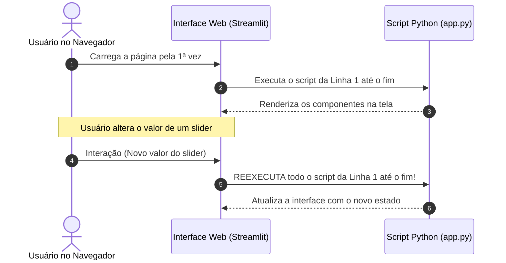
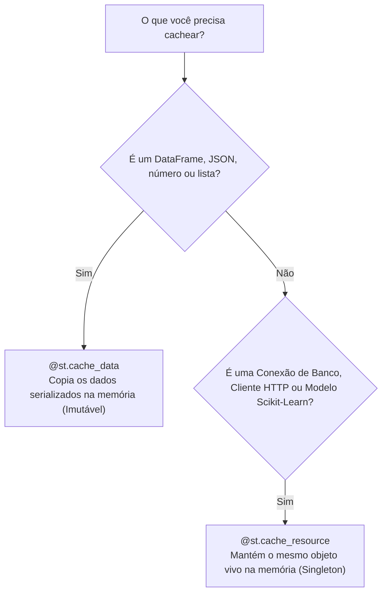

# 🎈 Guia Definitivo de Streamlit para Ciência de Dados (Princípio 80/20)

Este guia cobre os **20% de funcionalidades do Streamlit que geram 80% do impacto real** em projetos de Ciência de Dados e Machine Learning. Cada função e componente é apresentado com:

- 🎯 **Para que serve** (o objetivo e mecânica da função)
- 💡 **Quando utilizar** (cenários reais de Data Science e ML)
- ⚠️ **Quando NÃO utilizar** (más práticas e o que usar no lugar)
- 💻 **Exemplo prático** (código contextualizado no ecossistema do seu projeto `ga4_churn_predictor`)

---

## 📑 Índice

1. [Inicialização do Projeto e Mental Model do Streamlit](#1-inicialização-do-projeto-e-mental-model-do-streamlit)
   - [1.1 Instalação e Execução](#11-instalação-e-execução)
   - [1.2 O Mental Model Fundamental: Ciclo de Reexecução Top-to-Bottom](#12-o-mental-model-fundamental-ciclo-de-reexecução-top-to-bottom)
   - [1.3 Configuração Global da Página (`st.set_page_config`)](#13-configuração-global-da-página-stset_page_config)
   - [1.4 Estrutura de Pastas Recomendada no Projeto](#14-estrutura-de-pastas-recomendada-no-projeto)
2. [Componentes Essenciais de Interface (Core Streamlit)](#2-componentes-essenciais-de-interface-core-streamlit)
   - [2.1 Textos e Tipografia (`st.title`, `st.header`, `st.subheader`, `st.markdown`, `st.caption`, `st.code`)](#21-textos-e-tipografia)
   - [2.2 Cards de Métricas e KPIs (`st.metric`)](#22-cards-de-métricas-e-kpis-stmetric)
   - [2.3 Exibição de Dados: Interativo vs Estático (`st.dataframe` vs `st.table`)](#23-exibição-de-dados-interativo-vs-estático-stdataframe-vs-sttable)
   - [2.4 Inputs Numéricos: Precisão vs Faixa (`st.number_input` vs `st.slider`)](#24-inputs-numéricos-precisão-vs-faixa-stnumber_input-vs-stslider)
   - [2.5 Seletores: Dropdown vs Visível vs Múltiplo (`st.selectbox`, `st.radio`, `st.multiselect`)](#25-seletores-stselectbox-stradio-stmultiselect)
   - [2.6 Entradas de Texto (`st.text_input` vs `st.text_area`)](#26-entradas-de-texto-sttext_input-vs-sttext_area)
   - [2.7 Interruptores Booleanos (`st.toggle` vs `st.checkbox`)](#27-interruptores-booleanos-sttoggle-vs-stcheckbox)
   - [2.8 Botões de Ação (`st.button`) e a Armadilha da Volatilidade](#28-botões-de-ação-stbutton-e-a-armadilha-da-volatilidade)
   - [2.9 Upload e Download de Arquivos (`st.file_uploader` e `st.download_button`)](#29-upload-e-download-de-arquivos-stfile_uploader-e-stdownload_button)
3. [Layout, UX e Organização Visual](#3-layout-ux-e-organização-visual)
   - [3.1 Barra Lateral (`st.sidebar`)](#31-barra-lateral-stsidebar)
   - [3.2 Colunas Responsivas (`st.columns`)](#32-colunas-responsivas-stcolumns)
   - [3.3 Abas de Navegação (`st.tabs`)](#33-abas-de-navegação-sttabs)
   - [3.4 Detalhes Expansíveis (`st.expander`)](#34-detalhes-expansíveis-stexpander)
   - [3.5 Feedback Visual e Alertas (`st.spinner`, `st.success`, `st.warning`, `st.error`, `st.toast`)](#35-feedback-visual-e-alertas)
   - [3.6 Controle de Fluxo (`st.stop` e `st.rerun`)](#36-controle-de-fluxo-ststop-e-strerun)
4. [Visualização de Dados com Pandas, Matplotlib e Seaborn](#4-visualização-de-dados-com-pandas-matplotlib-e-seaborn)
   - [4.1 Gráficos Nativos Rápidos (`st.line_chart`, `st.bar_chart`)](#41-gráficos-nativos-rápidos-stline_chart-stbar_chart)
   - [4.2 Gráficos Estatísticos Customizados (`st.pyplot`)](#42-gráficos-estatísticos-customizados-stpyplot)
5. [Controle de Execução e Estado: Formulários e Session State](#5-controle-de-execução-e-estado-formulários-e-session-state)
   - [5.1 Formulários Atômicos (`st.form` e `st.form_submit_button`)](#51-formulários-atômicos-stform-e-stform_submit_button)
   - [5.2 Gerenciamento de Estado Persistente (`st.session_state`)](#52-gerenciamento-de-estado-persistente-stsession_state)
6. [Performance Crítica: Caching (`@st.cache_data` vs `@st.cache_resource`)](#6-performance-crítica-caching-stcache_data-vs-stcache_resource)
   - [6.1 Cache de Dados: `@st.cache_data`](#61-cache-de-dados-stcache_data)
   - [6.2 Cache de Recursos e Modelos de IA: `@st.cache_resource`](#62-cache-de-recursos-e-modelos-de-ia-stcache_resource)
7. [Mundo 1: Streamlit Standalone (Direto no Código / Sem API)](#7-mundo-1-streamlit-standalone-direto-no-código--sem-api)
   - [7.1 Para que serve e quando utilizar](#71-para-que-serve-e-quando-utilizar)
   - [7.2 Implementação Prática: Inferência Unitária e em Lote](#72-implementação-prática-inferência-unitária-e-em-lote)
   - [7.3 Prós e Contras da Abordagem Standalone](#73-prós-e-contras-da-abordagem-standalone)
8. [Mundo 2: Streamlit como Cliente da API FastAPI (Arquitetura Desacoplada)](#8-mundo-2-streamlit-como-cliente-da-api-fastapi-arquitetura-desacoplada)
   - [8.1 Para que serve e quando utilizar](#81-para-que-serve-e-quando-utilizar)
   - [8.2 Camada de Cliente HTTP Dedicada (`api_client.py`)](#82-camada-de-cliente-http-dedicada-api_clientpy)
   - [8.3 Implementação Prática: Interface Consumindo a API com Autenticação](#83-implementação-prática-interface-consumindo-a-api-com-autenticação)
   - [8.4 Prós e Contras da Abordagem Desacoplada](#84-prós-e-contras-da-abordagem-desacoplada)
9. [Comparativo Arquitetural: Quando Usar Direto vs. Quando Usar API?](#9-comparativo-arquitetural-quando-usar-direto-vs-quando-usar-api)
10. [Aplicações Multi-Páginas (Multi-Page Apps)](#10-aplicações-multi-páginas-multi-page-apps)
11. [Cheat Sheet 80/20 do Streamlit (Referência Rápida)](#11-cheat-sheet-8020-do-streamlit-referência-rápida)

---

## 1. Inicialização do Projeto e Mental Model do Streamlit

### 1.1 Instalação e Execução

No seu projeto gerenciado por `uv` (ou com `pip`), adicione o Streamlit:

```bash
# Com uv (recomendado para seu ambiente):
uv add streamlit

# Com pip tradicional:
pip install streamlit
```

Para rodar qualquer aplicativo Streamlit:

```bash
# Execução direta com uv:
uv run streamlit run src/ui/app.py

# Ou ativando o ambiente virtual:
source .venv/bin/activate
streamlit run src/ui/app.py
```

---

### 1.2 O Mental Model Fundamental: Ciclo de Reexecução Top-to-Bottom

> [!IMPORTANT]
> **A regra de ouro do Streamlit:** Toda vez que um usuário interage com qualquer elemento da tela (muda um slider, clica num botão, seleciona uma opção no dropdown), o Streamlit **reexecuta todo o script Python do início ao fim (linha 1 até a última linha)**.



Essa simplicidade é o superpoder do Streamlit: **o estado da tela reflete o valor atual das suas variáveis em tempo real**, sem precisar programar eventos complexos de callback.

Por outro lado, sem o uso correto de **Caching** e **Session State**, o script recarregaria arquivos pesados e refaria consultas lentas a cada clique.

---

### 1.3 Configuração Global da Página (`st.set_page_config`)

* 🎯 **Para que serve:** Define os metadados da aplicação na aba do navegador (título da aba, ícone favicon, menu recolhido e modo de layout).
* 💡 **Quando utilizar:** **Sempre**, na **primeira linha executável de Streamlit** de qualquer aplicação. Especialmente com `layout="wide"`, que estica a área útil da tela aproveitando monitores widescreen (essencial para dashboards com muitas colunas e gráficos).
* ⚠️ **Quando NÃO utilizar:** Nunca coloque `st.set_page_config` após qualquer outro comando `st.` (como `st.title` ou `st.write`). Se não for o primeiro comando da página, o Streamlit lançará uma exceção fatal (`StreamlitAPIException`).

```python
import streamlit as st

st.set_page_config(
    page_title="Preditor de Churn GA4",
    page_icon="🧠",
    layout="wide",                  # "centered" (estreito) ou "wide" (ocupa a largura inteira)
    initial_sidebar_state="expanded" # "auto", "expanded" ou "collapsed"
)
```

---

### 1.4 Estrutura de Pastas Recomendada no Projeto

```text
06_Aprendendo_Streamlit/
│
├── models/                           # 🧠 Modelos treinados (.joblib)
│   └── churn_model.joblib
│
├── sql/                              # 쿼 Consultas BigQuery / SQL
│   └── extract_churn_features.sql
│
├── src/
│   ├── ga4_churn_predictor/          # 📦 Pacote de dados e ML (lógica pura)
│   │   ├── config.py
│   │   ├── data.py
│   │   ├── pipeline.py
│   │   └── predict.py                # Funções predict_single e predict_batch
│   │
│   ├── app/                          # 🚀 Backend FastAPI (quando houver API)
│   │   ├── main.py
│   │   ├── routers/
│   │   ├── schemas/
│   │   └── services/
│   │
│   └── ui/                           # 🎈 CAMADA STREAMLIT (FRONTEND)
│       ├── app.py                    # Ponto de entrada da aplicação
│       ├── api_client.py             # Cliente HTTP para falar com a FastAPI
│       └── pages/                    # Telas multi-páginas (opcional)
│           ├── 1_dashboard.py
│           ├── 2_predicao_direta.py
│           └── 3_predicao_api.py
│
├── pyproject.toml
└── README.md
```

---

## 2. Componentes Essenciais de Interface (Core Streamlit)

---

### 2.1 Textos e Tipografia

#### `st.title`, `st.header`, `st.subheader`

* 🎯 **Para que serve:** Definem a hierarquia tipográfica da página (equivalentes aos elementos HTML `<h1>`, `<h2>` e `<h3>`).
* 💡 **Quando utilizar:**
  - `st.title`: Uma única vez no topo absoluto da página para dar nome ao aplicativo/dashboard.
  - `st.header`: Para grandes seções temáticas (ex: "Entrada de Dados", "Resultados da Inferência").
  - `st.subheader`: Para subdivisões dentro de uma seção ou títulos de gráficos e cartões.
* ⚠️ **Quando NÃO utilizar:** Não use para textos corridos, notas explicativas ou parágrafos longos.

#### `st.markdown`

* 🎯 **Para que serve:** Renderiza texto rico com formatação em Markdown (negrito, itálico, listas, tabelas, links) e expressões matemáticas em LaTeX.
* 💡 **Quando utilizar:** Para explicações conceituais, descrições de regras de negócio, notas de rodapé ou fórmulas matemáticas da modelagem.
* ⚠️ **Quando NÃO utilizar:** Quando precisar de tipografia semântica estrutural (use `st.title`/`st.header` para estruturar a página).

#### `st.caption` e `st.code`

* 🎯 **Para que serve:**
  - `st.caption`: Renderiza texto pequeno e com tom atenuado (cinza).
  - `st.code`: Renderiza blocos de código com destaque de sintaxe e botão nativo de "Copiar".
* 💡 **Quando utilizar:**
  - `st.caption`: Para rodapés discretos, metadados (ex: "Versão do modelo: v1.0 | Retreino: 05/10/2026") ou legendas de gráficos.
  - `st.code`: Para exibir queries SQL (BigQuery), respostas JSON da API ou snippets de código para documentação.

```python
import streamlit as st

# Título da Aplicação (h1)
st.title("📊 Painel de Previsão de Churn GA4")

# Seção Principal (h2)
st.header("1. Simulação Preditiva")

# Subseção (h3)
st.subheader("Parâmetros do Modelo")

# Texto rico com Markdown e LaTeX
st.markdown("""
O modelo calcula a probabilidade condicional de evasão $P(Churn = 1 \mid X)$ 
baseado em **11 variáveis comportamentais** extraídas do Google Analytics 4.
""")

# Metadado discreto
st.caption("Pipeline treinado com Scikit-Learn e Random Forest Classifier.")

# Bloco de código com botão de cópia
st.code("""
SELECT user_pseudo_id, SUM(purchase_revenue_in_usd) AS receita_total
FROM `sandbox-508815.analytics.events`
GROUP BY user_pseudo_id;
""", language="sql")
```

---

### 2.2 Cards de Métricas e KPIs (`st.metric`)

* 🎯 **Para que serve:** Cria um cartão visual de destaque para indicadores numéricos fundamentais (KPIs), com suporte opcional a indicador de variação (`delta`).
* 💡 **Quando utilizar:**
  - Exibir métricas de avaliação do modelo (Acurácia, F1-Score, AUC-ROC).
  - Apresentar o resultado final da inferência (Probabilidade de Churn: `74.5%`).
  - Painéis executivos no topo da página (Total de Clientes em Risco, Ticket Médio, Receita em Risco).
* ⚠️ **Quando NÃO utilizar:** Para textos descritivos longos ou tabelas com muitos dados. `st.metric` é exclusivamente para valores únicos de alto impacto.

```python
import streamlit as st

col1, col2, col3, col4 = st.columns(4)

col1.metric(
    label="Acurácia do Modelo", 
    value="88.2%", 
    delta="+1.4%" # delta positivo em verde
)

col2.metric(
    label="Taxa de Churn Prevista", 
    value="34.1%", 
    delta="-2.0%", 
    delta_color="inverse" # delta_color="inverse": queda é considerada positiva!
)

col3.metric(
    label="Receita em Risco", 
    value="$ 12,450", 
    delta="+$ 1,200", 
    delta_color="inverse"
)

col4.metric(
    label="Tempo de Inferência", 
    value="12 ms"
)
```

---

### 2.3 Exibição de Dados: Interativo vs Estático (`st.dataframe` vs `st.table`)

#### `st.dataframe`

* 🎯 **Para que serve:** Renderiza DataFrames do Pandas com tabela rica e interativa (permite ao usuário ordenar colunas clicando no cabeçalho, pesquisar texto, redimensionar colunas e baixar como CSV).
* 💡 **Quando utilizar:** **95% dos casos em Data Science.** Ideal para exibir dados brutos, resultados de predições em lote e tabelas analíticas com dezenas ou centenas de linhas.
* ⚠️ **Quando NÃO utilizar:** Em DataFrames gigantes com milhões de linhas (o navegador do cliente vai travar ao renderizar). Sempre aplique um limitador antes (`df.head(1000)`).

#### `st.table`

* 🎯 **Para que serve:** Renderiza uma tabela HTML estática pura (sem rolagem interna, sem ordenação e sem busca).
* 💡 **Quando utilizar:** Exclusivamente para tabelas muito pequenas (2 a 6 linhas) que devem aparecer totalmente abertas e prontas para impressão ou captura de tela (ex: uma Matriz de Confusão 2x2 ou uma tabela de hiperparâmetros).

```python
import streamlit as st
import pandas as pd

df_clientes = pd.DataFrame({
    "ID": [101, 102, 103, 104],
    "Receita_USD": [150.0, 420.5, 30.0, 950.0],
    "Recencia_Dias": [10, 5, 80, 2],
    "Probabilidade_Churn": [0.15, 0.08, 0.85, 0.02]
})

st.subheader("Base com Predições (Interativo)")
# Interativo: usuário clica na coluna para ordenar e pode pesquisar
st.dataframe(
    df_clientes, 
    use_container_width=True, 
    hide_index=True
)

st.subheader("Matriz de Confusão (Estático)")
matriz_confusao = pd.DataFrame(
    [[850, 40], [60, 50]], 
    columns=["Predito: Ativo", "Predito: Churn"],
    index=["Real: Ativo", "Real: Churn"]
)
# Estático: compacto, sem scroll, perfeito para exibição de validação
st.table(matriz_confusao)
```

---

### 2.4 Inputs Numéricos: Precisão vs Faixa (`st.number_input` vs `st.slider`)

#### `st.number_input`

* 🎯 **Para que serve:** Caixa de entrada numérica onde o usuário digita um valor exato ou utiliza botões de incremento/decremento (`+` e `-`).
* 💡 **Quando utilizar:** Para variáveis sem teto definido ou onde a precisão exata é indispensável (ex: `receita_total_em_usd`, `total_pedidos`, `ticket_medio`).
* ⚠️ **Quando NÃO utilizar:** Para faixas contínuas limitadas e intuitivas (como probabilidades de 0 a 1), onde digitar um número é menos agradável do que arrastar.

#### `st.slider`

* 🎯 **Para que serve:** Barra deslizante contínua ou discreta entre um valor mínimo e um valor máximo.
* 💡 **Quando utilizar:** Para probabilidades, porcentagens, faixas de datas ou pontos de corte (ex: `limiar_de_corte` de 0.0 a 1.0, ou nota de satisfação de 1 a 5).
* ⚠️ **Quando NÃO utilizar:** Quando o usuário precisa inserir valores com ordens de grandeza muito variadas (ex: faturamento de R$ 10 até R$ 1.000.000). O slider fica difícil de posicionar com precisão.

```python
import streamlit as st

# number_input: precisão cirúrgica para variáveis de entrada
receita = st.number_input(
    label="Receita Total do Cliente (USD)",
    min_value=0.0,
    max_value=100000.0,
    value=150.0,
    step=10.0,
    help="Soma total do valor das transações registradas."
)

# slider: ajuste visual contínuo de sensibilidade do modelo
threshold = st.slider(
    label="Limiar de Probabilidade de Churn (Threshold)",
    min_value=0.0,
    max_value=1.0,
    value=0.50,
    step=0.05,
    help="Probabilidade mínima para considerar que o cliente cancelará."
)
```

---

### 2.5 Seletores: Dropdown vs Visível vs Múltiplo (`st.selectbox`, `st.radio`, `st.multiselect`)

#### `st.selectbox`

* 🎯 **Para que serve:** Menu suspenso (dropdown) para escolher **uma única opção**.
* 💡 **Quando utilizar:** Quando existem **mais de 4 opções** disponíveis (ex: lista de 27 estados, lista de 50 canais de marketing). Economiza espaço vertical na tela.

#### `st.radio`

* 🎯 **Para que serve:** Exibe todas as opções lado a lado ou empilhadas com botões circulares de seleção única.
* 💡 **Quando utilizar:** Quando existem **poucas opções (2 a 4)** e você quer que o usuário visualize todas imediatamente sem precisar clicar para abrir o menu (ex: "Modo: Produção / Teste", "Visualização: Gráfico / Tabela").

#### `st.multiselect`

* 🎯 **Para que serve:** Caixa de seleção com tags que permite escolher **múltiplas opções** simultaneamente.
* 💡 **Quando utilizar:** Para filtros de dimensões em dashboards de dados (ex: "Selecione as categorias analisadas", "Filtrar por regiões").

```python
import streamlit as st

# st.radio: poucas opções, visibilidade imediata
ambiente = st.radio(
    label="Ambiente de Execução",
    options=["Produção", "Homologação"],
    horizontal=True # opções lado a lado
)

# st.selectbox: muitas opções, compacto
pais_origem = st.selectbox(
    label="País de Origem do Usuário",
    options=["Brasil", "Estados Unidos", "Alemanha", "Portugal", "Reino Unido", "Outros"]
)

# st.multiselect: filtro múltiplo para consultas
campanhas = st.multiselect(
    label="Filtrar por Campanhas de Origem",
    options=["Black Friday", "Google Ads Natal", "Orgânico SEO", "Email Marketing Retenção"],
    default=["Black Friday", "Google Ads Natal"]
)
```

---

### 2.6 Entradas de Texto (`st.text_input` vs `st.text_area`)

#### `st.text_input`

* 🎯 **Para que serve:** Campo de texto de linha única. Suporta o parâmetro `type="password"` para ocultar caracteres com bolinhas.
* 💡 **Quando utilizar:** Busca por identificador único (ID de usuário, CPF, SKU de produto) ou inserção de senhas e chaves de API (`X-API-KEY`).

#### `st.text_area`

* 🎯 **Para que serve:** Caixa de texto expansível com múltiplas linhas.
* 💡 **Quando utilizar:** Entrada de textos longos, colar payloads JSON manuais ou redigir consultas SQL personalizadas diretamente na interface.

```python
import streamlit as st

# text_input com máscara para segredos
api_key = st.text_input(
    label="Chave Secreta da API (X-API-KEY)",
    value="",
    type="password",
    help="Necessária para autorizar chamadas ao backend FastAPI."
)

# text_area para payloads ou queries
query_sql = st.text_area(
    label="Consulta BigQuery Customizada",
    value="SELECT * FROM `dataset.churn_features` LIMIT 100;",
    height=100
)
```

---

### 2.7 Interruptores Booleanos (`st.toggle` vs `st.checkbox`)

#### `st.toggle`

* 🎯 **Para que serve:** Interruptor deslizante moderno (liga/desliga).
* 💡 **Quando utilizar:** Para ativar ou desativar **modos de exibição ou comportamentos da aplicação** (ex: "Modo Avançado", "Exibir Métricas Técnicas", "Usar Cache Local").
* ⚠️ **Quando NÃO utilizar:** Para confirmações formais de leitura ou aceitação de termos.

#### `st.checkbox`

* 🎯 **Para que serve:** Caixa tradicional de marcação quadrada.
* 💡 **Quando utilizar:** Para termos de uso ("Li e concordo"), filtros binários pontuais em tabelas ("Apenas clientes com churn") ou confirmações antes de ações destrutivas ("Confirmar exclusão").

```python
import streamlit as st

# st.toggle: perfeito para alternar a experiência do usuário
modo_tecnico = st.toggle("Exibir Diagnóstico Técnico da Inferência", value=False)

if modo_tecnico:
    st.info("Matriz de probabilidades brutas: `[[0.28, 0.72]]`")

# st.checkbox: perfeito para filtros condicionais de dados
apenas_em_risco = st.checkbox("Filtrar apenas clientes classificados como Churn", value=True)
```

### 2.8 Botões de Ação (`st.button`) e a Armadilha da Volatilidade

#### `st.button`

* 🎯 **Para que serve:** É um gatilho de ação pontual e transitório (*stateless trigger*). Ele retorna `True` **apenas e exclusivamente no ciclo de execução exato em que foi clicado**. Assim que o script termina de rodar ou qualquer outro componente da tela é acionado em seguida, o botão volta imediatamente a retornar `False`.
* 💡 **Quando utilizar:**
  - Disparar ações pontuais: "Testar Conexão com API", "Executar Predição", "Calcular Diagnóstico".
  - Ações de controle de sessão com `st.rerun()`: "Limpar Histórico", "Resetar Filtros", "Deslogar".
* ⚠️ **A Maior Armadilha do `st.button` (O que NUNCA fazer):**
  - **NÃO coloque novos inputs ou formulários dependentes dentro de um `if st.button:`!**Como o botão só permanece `True` durante aquele clique, se você colocar um `st.selectbox`, `st.slider` ou formulário dentro do `if st.button:`, assim que o usuário interagir com esse segundo widget, a página inteira reexecuta, o botão volta para `False` e o widget filho **desaparece da tela como mágica!**
    ```python
    # ❌ ERRO CLÁSSICO DE INICIANTE (O campo desaparece no segundo clique!):
    if st.button("Configurar Cliente"):
        categoria = st.selectbox("Canal de Aquisição", ["Ads", "Orgânico"]) # O usuário clica aqui...
        # A página roda de novo, st.button vira False e o selectbox DESAPARECE!

    # ✅ JEITO CERTO: Use st.expander, st.toggle ou st.session_state para manter caixas abertas:
    with st.expander("Configurar Cliente"):
        categoria = st.selectbox("Canal de Aquisição", ["Ads", "Orgânico"])
    ```
  - **NÃO use `st.button` dentro de `st.form`:** Dentro de um formulário, o único botão permitido é o `st.form_submit_button`. Tentar colocar um `st.button` comum dentro de um form lança uma exceção do Streamlit.

#### Parâmetros Essenciais de Estilo e Controle:

* `type="primary"`: Destaca o botão com a cor primária vibrante do tema (ideal para ações principais como "Executar Predição"). O padrão é `type="secondary"` (cinza discreto).
* `icon`: Adiciona um ícone ou emoji dentro do botão (`icon="⚡"`, `icon=":material/play_arrow:"`, `icon="🧹"`).
* `use_container_width=True`: Faz o botão ocupar 100% da largura da coluna onde está inserido.
* `disabled=True/False`: Desabilita o clique dinamicamente (ex: desabilita enquanto o modelo não carregar).
* `help`: Exibe um tooltip explicativo ao passar o mouse.

```python
import streamlit as st

col1, col2 = st.columns(2)

with col1:
    # Botão de destaque principal com ícone e largura total
    if st.button("Executar Predição", type="primary", icon="⚡", use_container_width=True):
        st.success("Predição executada com sucesso!")

with col2:
    # Botão secundário para resetar sessão
    if st.button("Limpar Histórico", type="secondary", icon="🧹", use_container_width=True):
        st.session_state.clear()
        st.toast("Histórico reiniciado!", icon="🗑️")
        st.rerun()
```

---

### 2.9 Upload e Download de Arquivos (`st.file_uploader` e `st.download_button`)

#### `st.file_uploader`

* 🎯 **Para que serve:** Permite que o usuário envie arquivos do computador dele (CSV, XLSX, Parquet, Imagens) para a aplicação Streamlit em tempo de execução. O arquivo é recebido como um objeto em memória tipo `BytesIO`.
* 💡 **Quando utilizar:** **Inferência em lote**, auditoria de planilhas fornecidas pelo usuário final e importação de bases de teste.
* ⚠️ **Quando NÃO utilizar:** Para carregar bases fixas do seu projeto que já existem no servidor (ex: `dataset/raw/users.parquet`). Para arquivos locais, use `pd.read_parquet()` direto.

#### `st.download_button`

* 🎯 **Para que serve:** Cria um botão que transfere arquivos gerados na aplicação diretamente para a pasta de downloads do navegador do usuário.
* 💡 **Quando utilizar:** Exportar predições geradas pelo modelo (CSV enriquecido), relatórios analíticos, gráficos ou logs de auditoria.

```python
import streamlit as st
import pandas as pd

# 1. Entrada: Upload de arquivo
arquivo_cliente = st.file_uploader(
    label="Faça upload da lista de clientes (CSV)",
    type=["csv"],
    help="O arquivo deve conter as 11 colunas exigidas pelo modelo GA4."
)

if arquivo_cliente is not None:
    # Leitura direta com Pandas através do buffer de memória
    df_recebido = pd.read_csv(arquivo_cliente)
    st.success(f"{len(df_recebido)} registros importados com sucesso!")

    # 2. Saída: Download dos resultados gerados
    csv_bytes = df_recebido.to_csv(index=False).encode("utf-8")
    st.download_button(
        label="📥 Baixar Base com Predições (CSV)",
        data=csv_bytes,
        file_name="resultado_predicoes_churn.csv",
        mime="text/csv"
    )
```

---

## 3. Layout, UX e Organização Visual

---

### 3.1 Barra Lateral (`st.sidebar`)

* 🎯 **Para que serve:** Cria uma gaveta retrátil e fixa no canto esquerdo da tela para acomodar controles que afetam a página como um todo.
* 💡 **Quando utilizar:**
  - Configurações de conexão (URL da API, token de autenticação, seleção de ambiente).
  - Filtros globais que alteram todos os gráficos da tela (filtro de data, canal de venda).
  - Informações de status do sistema (status da IA, versão do modelo).
* ⚠️ **Quando NÃO utilizar:** Para o conteúdo principal do dashboard. Tabelas de resultado e gráficos centrais pertencem à área principal da página.

```python
import streamlit as st

# Usando o prefixo direto:
st.sidebar.title("Configurações")
st.sidebar.text_input("Chave de API", type="password")

# Ou usando context manager com 'with':
with st.sidebar:
    st.subheader("Parâmetros do Modelo")
    limiar = st.slider("Threshold de Churn", 0.0, 1.0, 0.5)
```

---

### 3.2 Colunas Responsivas (`st.columns`)

* 🎯 **Para que serve:** Divide o fluxo vertical padrão da página em colunas horizontais lado a lado com larguras configuráveis.
* 💡 **Quando utilizar:**
  - Agrupar múltiplos cartões de KPIs executivos lado a lado (`st.columns(4)`).
  - Compactar formulários (ex: colocar 3 campos de entrada por linha).
  - Colocar um gráfico explicativo ao lado de uma tabela de apoio (ex: `st.columns([7, 3])` para 70% gráfico e 30% resumo).
* ⚠️ **Quando NÃO utilizar:** Mais de 4 ou 5 colunas em monitores comuns deixam os componentes espremidos e ilegíveis.

```python
import streamlit as st

# Divisão proporcional: Coluna 1 ocupa o dobro da largura da Coluna 2
col_grafico, col_metricas = st.columns([2, 1])

with col_grafico:
    st.subheader("Visualização da Distribuição")
    # Gráfico aqui...

with col_metricas:
    st.subheader("Resumo Executivo")
    st.metric("Total de Clientes", "1,250")
    st.metric("Ticket Médio", "$ 65.40")
```

---

### 3.3 Abas de Navegação (`st.tabs`)

* 🎯 **Para que serve:** Cria guias horizontais clicáveis que alternam a visão do conteúdo sem recarregar o script e sem sair da página atual.
* 💡 **Quando utilizar:** Para organizar jornadas complementares de um mesmo problema sem criar uma página com rolagem infinita (ex: **Aba 1: Predição Individual**, **Aba 2: Predição em Lote**, **Aba 3: Métricas Técnicas do Modelo**).
* ⚠️ **Quando NÃO utilizar:** Quando os passos dependem estritamente um do outro em sequência obrigatória (nesse caso, use um fluxo sequencial na tela ou `st.form`).

```python
import streamlit as st

aba_individual, aba_lote, aba_sobre = st.tabs([
    "🎯 Predição Individual", 
    "📁 Lote (CSV)", 
    "ℹ️ Sobre o Modelo"
])

with aba_individual:
    st.write("Formulário de predição unitária...")

with aba_lote:
    st.write("Upload de planilha...")

with aba_sobre:
    st.write("Informações do pipeline e hiperparâmetros...")
```

---

### 3.4 Detalhes Expansíveis (`st.expander`)

* 🎯 **Para que serve:** Cria uma caixa sanfonada recolhível que esconde conteúdo secundário até que o usuário clique para expandir.
* 💡 **Quando utilizar:**
  - Ocultar detalhes técnicos que poluiriam a tela para usuários de negócio (dicionário de variáveis, JSON bruto retornado pela API, logs de execução).
  - Explicar regras de negócio detalhadas (ex: "Como é calculado o churn no GA4?").
* ⚠️ **Quando NÃO utilizar:** Para o resultado principal ou botões de ação essenciais. O usuário não deve ter que clicar em um expander para ver se o cliente cancelou ou não.

```python
import streamlit as st

st.success("Inferência calculada com sucesso!")

with st.expander("🔍 Ver JSON Bruto Retornado pelo Servidor"):
    st.json({
        "predicao_classe": 1,
        "predicao_probabilidade": 0.74,
        "predicao_status": "Churn",
        "tempo_ms": 14.2
    })
```

---

### 3.5 Feedback Visual e Alertas

#### `st.spinner`

* 🎯 **Para que serve:** Exibe uma animação elegante de carregamento ("carregando...") enquanto um bloco demorado de código Python é executado.
* 💡 **Quando utilizar:** **Sempre** que executar operações com latência perceptível (> 500 ms): chamadas de inferência do modelo (`predict`), consultas no BigQuery ou requisições HTTP para a FastAPI.

#### `st.success`, `st.error`, `st.warning`, `st.info`

* 🎯 **Para que serve:** Banners coloridos com ícones que comunicam status semântico imediato:
  - `st.success` (Verde): Operação realizada com sucesso, cliente retido/saudável.
  - `st.error` (Vermelho): Falhas, erros de conexão, alerta crítico de churn iminente.
  - `st.warning` (Amarelo): Avisos, limiares de atenção, colunas ausentes não críticas.
  - `st.info` (Azul): Mensagens informativas e instruções de uso.

#### `st.toast`

* 🎯 **Para que serve:** Notificação flutuante temporária no canto inferior direito que se apaga sozinha após 4 segundos.
* 💡 **Quando utilizar:** Para confirmações rápidas e secundárias sem ocupar espaço permanente no fluxo da tela (ex: "Filtros redefinidos!", "Histórico limpo com sucesso!").

```python
import streamlit as st
import time

# Spinner: bloqueia visualmente indicando processamento ativo
with st.spinner("Executando inferência com Scikit-Learn..."):
    time.sleep(1.0) # Simula o processamento do modelo

# Banners semânticos
st.success("Predição concluída!")
st.warning("Atenção: A recência deste cliente é superior a 60 dias.")
st.error("Erro: A chave de API informada é inválida (401 Unauthorized).")

# Notificação temporária não invasiva
st.toast("Resultados salvos na sessão!", icon="💾")
```

---

### 3.6 Controle de Fluxo (`st.stop` e `st.rerun`)

#### `st.stop`

* 🎯 **Para que serve:** Interrompe a execução do script Python naquele ponto exato, impedindo que o restante da página seja renderizado.
* 💡 **Quando utilizar:** Quando uma pré-condição crítica falhar (ex: o arquivo do modelo `.joblib` não foi encontrado no disco, a API está offline, ou o usuário não inseriu a chave de API obrigatória). Evita que o app quebre mais abaixo com erros feios de `Traceback`.

#### `st.rerun`

* 🎯 **Para que serve:** Força o Streamlit a reiniciar a execução do script imediatamente do topo (da linha 1).
* 💡 **Quando utilizar:** Logo após alterar o `st.session_state` por meio de um botão (ex: botão "Limpar Histórico" ou "Resetar Filtros"), garantindo que a tela redesenhe instantaneamente com o novo estado limpo.

```python
import streamlit as st
from pathlib import Path

# st.stop: trava a página com elegância se o arquivo não existir
caminho_modelo = Path("models/churn_model.joblib")
if not caminho_modelo.exists():
    st.error(f"Arquivo do modelo não encontrado em: `{caminho_modelo}`. Treine o modelo antes de rodar o app.")
    st.stop() # NADA abaixo desta linha será executado!

# st.rerun: atualiza a tela após limpar o estado
if st.button("Limpar Dados"):
    st.session_state.clear()
    st.rerun() # Recarrega a página imediatamente do topo
```

---

## 4. Visualização de Dados com Pandas, Matplotlib e Seaborn

---

### 4.1 Gráficos Nativos Rápidos (`st.line_chart`, `st.bar_chart`)

* 🎯 **Para que serve:** Renderizam gráficos interativos pré-configurados baseados em Altair diretamente a partir de DataFrames do Pandas, com zero código de customização.
* 💡 **Quando utilizar:** Análises exploratórias rápidas, séries temporais simples (ex: interações por quinzena) ou distribuições de frequência diretas.
* ⚠️ **Quando NÃO utilizar:** Quando precisar de gráficos estatísticos avançados, paletas de cores customizadas rigorosas, anotações de texto no gráfico ou gráficos específicos de Ciência de Dados (como Matriz de Confusão, Curva ROC ou Boxplots complexos).

```python
import streamlit as st
import pandas as pd

# Exibição direta de tendência temporal das quinzenas
dados_quinzenas = pd.DataFrame({
    "Quinzena": ["Q1", "Q2", "Q3", "Q4"],
    "Interações": [15, 12, 6, 1]
}).set_index("Quinzena")

st.subheader("Tendência de Interações do Cliente")
st.line_chart(dados_quinzenas)
```

---

### 4.2 Gráficos Estatísticos Customizados (`st.pyplot`)

* 🎯 **Para que serve:** Renderiza figuras criadas com **Matplotlib** ou **Seaborn** diretamente na tela do Streamlit.
* 💡 **Quando utilizar:** Gráficos de EDA e diagnóstico de Machine Learning (Scatterplots com regressão, Boxplots de recência por classe, Heatmaps de correlação, Histogramas com KDE).
* ⚠️ **Regra de Ouro (Prevenção de Vazamento de Memória):**
  - **Sempre** instancie a figura explicitamente: `fig, ax = plt.subplots(...)`.
  - Passe a figura para o Streamlit: `st.pyplot(fig)`.
  - **Sempre** feche a figura em seguida com `plt.close(fig)` para liberar a memória RAM do servidor.

```python
import streamlit as st
import matplotlib.pyplot as plt
import seaborn as sns
import pandas as pd

df_amostra = pd.DataFrame({
    "recencia_dias": [5, 12, 45, 60, 2, 80, 15, 90, 10, 3],
    "receita_total_em_usd": [250, 400, 50, 30, 800, 10, 310, 5, 620, 950],
    "churn": [0, 0, 1, 1, 0, 1, 0, 1, 0, 0]
})

st.subheader("Dispersão: Recência vs Receita")

# 1. Criação isolada da figura
fig, ax = plt.subplots(figsize=(7, 3.5))

sns.scatterplot(
    data=df_amostra,
    x="recencia_dias",
    y="receita_total_em_usd",
    hue="churn",
    palette={0: "#2ecc71", 1: "#e74c3c"},
    s=120,
    ax=ax
)

ax.set_title("Identificação de Risco por Padrão de Compra")
ax.set_xlabel("Dias sem Comprar (Recência)")
ax.set_ylabel("Receita Total (USD)")
ax.grid(True, linestyle="--", alpha=0.5)

# 2. Renderização segura no Streamlit
st.pyplot(fig)

# 3. Liberação imediata da memória
plt.close(fig)
```

---

## 5. Controle de Execução e Estado: Formulários e Session State

---

### 5.1 Formulários Atômicos (`st.form` e `st.form_submit_button`)

* 🎯 **Para que serve:** Agrupa múltiplos widgets de entrada e **bloqueia as reexecuções automáticas do script** até que o usuário clique explicitamente no botão de submissão do formulário.
* 💡 **Quando utilizar:** **Em qualquer tela de simulação de Machine Learning que receba múltiplos parâmetros** (como as 11 variáveis do nosso modelo GA4). Sem o formulário, se o usuário preenchesse 11 campos, a página seria reexecutada 11 vezes seguidas.
* ⚠️ **Quando NÃO utilizar:** Para filtros dinâmicos de dashboards onde a intenção é exatamente ver os gráficos mudando ao vivo enquanto o usuário arrasta um slider.

```python
import streamlit as st

# Início do formulário com chave única
with st.form(key="form_simulador_churn"):
    col1, col2 = st.columns(2)
    with col1:
        pedidos = st.number_input("Total Pedidos", min_value=1, value=3)
        receita = st.number_input("Receita (USD)", min_value=0.0, value=150.0)
    with col2:
        recencia = st.number_input("Recência (dias)", min_value=0, value=20)
        itens = st.number_input("Total Itens", min_value=1, value=5)

    # Botão obrigatório de submissão:
    submetido = st.form_submit_button("Calcular Churn", type="primary")

# Este bloco abaixo SÓ roda quando o botão for clicado!
if submetido:
    st.write(f"Executando predição para {pedidos} pedidos e ${receita} de receita...")
```

---

### 5.2 Gerenciamento de Estado Persistente (`st.session_state`)

* 🎯 **Para que serve:** Funciona como um **dicionário Python que sobrevive na memória entre as reexecuções da página**. Garante que variáveis não sejam zeradas toda vez que o usuário clicar em algo na tela.
* 💡 **Quando utilizar:**
  - Armazenar o **histórico de simulações** feitas durante a visita do usuário.
  - Guardar o token ou chave de API digitada para reutilizar em várias telas.
  - Implementar paginação ou contadores de consultas.
* ⚠️ **Quando NÃO utilizar:** Para dados estáticos que pertencem a todos os usuários da aplicação (para isso, use `@st.cache_resource` ou `@st.cache_data`). O `session_state` é isolado para cada aba de navegador aberta.

```python
import streamlit as st

# 1. Padrão de inicialização: verificar se a chave já existe no dicionário
if "historico_predicoes" not in st.session_state:
    st.session_state.historico_predicoes = []

# 2. Modificação do estado
if st.button("Adicionar Consulta"):
    st.session_state.historico_predicoes.append({
        "consulta_id": len(st.session_state.historico_predicoes) + 1,
        "status": "Processado"
    })

# 3. Leitura e exibição dos dados persistidos
st.write(f"Total de consultas armazenadas: {len(st.session_state.historico_predicoes)}")
st.dataframe(st.session_state.historico_predicoes)
```

---

## 6. Performance Crítica: Caching (`@st.cache_data` vs `@st.cache_resource`)



---

### 6.1 Cache de Dados: `@st.cache_data`

* 🎯 **Para que serve:** Executa uma função cara uma única vez e armazena uma cópia serializada do seu **retorno de dados** em memória. Se a função for chamada novamente com os mesmos parâmetros, o Streamlit retorna os dados da memória instantaneamente.
* 💡 **Quando utilizar:**
  - Consultas SQL no Google BigQuery (`query_to_dataframe`).
  - Leitura de arquivos `.parquet` ou `.csv` do disco.
  - Transformações pesadas de DataFrames no Pandas.
  - Requisições HTTP para APIs externas que retornam listas ou dicionários.
* ⚠️ **Quando NÃO utilizar:** Para objetos que mantêm conexões abertas de rede (bancos de dados, sockets) ou modelos de IA compilados na memória.

```python
import streamlit as st
import pandas as pd
import time

# ttl=3600: o cache expira e refaz a consulta automaticamente após 1 hora
@st.cache_data(ttl=3600)
def carregar_dados_bigquery(query_sql: str) -> pd.DataFrame:
    time.sleep(2.0) # Simula a latência da consulta no BigQuery
    return pd.DataFrame({"cliente_id": [1, 2], "receita": [150.0, 300.0]})

# Na primeira chamada, demora 2 segundos. Nas próximas, o retorno é instantâneo (0 ms):
df = carregar_dados_bigquery("SELECT * FROM clientes")
```

---

### 6.2 Cache de Recursos e Modelos de IA: `@st.cache_resource`

* 🎯 **Para que serve:** Mantém uma **única instância viva (Singleton)** de um objeto complexo na memória RAM global do servidor, sem serialização e sem duplicação de memória.
* 💡 **Quando utilizar:**
  - Carregamento de modelos de Machine Learning Scikit-Learn / Joblib (`churn_model.joblib`).
  - Pools de conexão com banco de dados SQLAlchemy (`create_engine`).
  - Clientes de API ou conexões com GCP BigQuery (`bigquery.Client()`).
* ⚠️ **Quando NÃO utilizar:** Para DataFrames ou variáveis que mudam frequentemente durante a interação do usuário.

```python
import streamlit as st
import joblib
from pathlib import Path
from sklearn.pipeline import Pipeline

@st.cache_resource(show_spinner="Carregando modelo na memória RAM...")
def carregar_pipeline_ml(caminho_arquivo: str) -> Pipeline:
    caminho = Path(caminho_arquivo)
    if not caminho.exists():
        raise FileNotFoundError(f"Arquivo não encontrado: {caminho}")
    return joblib.load(caminho)

# Carrega o arquivo de 370 KB uma única vez para todos os usuários:
modelo = carregar_pipeline_ml("models/churn_model.joblib")
```

---

## 7. Mundo 1: Streamlit Standalone (Direto no Código / Sem API)

### 7.1 Para que serve e quando utilizar

* 🎯 **O que é:** O Streamlit importa diretamente os módulos Python do seu pacote (`ga4_churn_predictor.predict`). O modelo de IA é carregado na mesma memória RAM do processo da interface web.
* 💡 **Quando utilizar:**
  - **Fase de Experimentação e Análise Exploratória (EDA).**
  - **Protótipos Rápidos (MVPs)** apresentados para clientes ou stakeholders internos.
  - Quando você é o único cientista de dados e não há necessidade de outros sistemas consumirem as predições.
* ⚠️ **Quando NÃO utilizar:** Em sistemas corporativos com múltiplos clientes (aplicativo mobile, dashboards externos, pipelines assíncronos) ou quando o modelo consumir dezenas de Gigabytes de GPU/RAM.

```mermaid
graph LR
    subgraph Processo Único (Streamlit)
        UI[Interface Web: app.py] -->|Import direto| Predict[ga4_churn_predictor.predict]
        Predict -->|Carrega via @st.cache_resource| Model[churn_model.joblib]
    end
```

---

### 7.2 Implementação Prática: Inferência Unitária e em Lote

```python
# src/ui/app_standalone.py
import streamlit as st
import pandas as pd
from pathlib import Path
from ga4_churn_predictor.predict import load_model, predict_single, predict_batch
from ga4_churn_predictor.config import MODEL_PATH

st.set_page_config(page_title="Modo Standalone", page_icon="🧠", layout="wide")

@st.cache_resource
def obter_modelo():
    return load_model(MODEL_PATH)

modelo = obter_modelo()
st.title("🧠 Preditor de Churn — Modo Standalone")

# 1. Inferência Unitária com Formulário
with st.form("form_standalone"):
    c1, c2 = st.columns(2)
    with c1:
        pedidos = st.number_input("Total Pedidos", min_value=1, value=3)
        receita = st.number_input("Receita (USD)", min_value=0.01, value=150.0)
        recencia = st.number_input("Recência (dias)", min_value=0, value=15)
        dias_1 = st.number_input("Dias desde 1º Pedido", min_value=0, value=60)
        tempo_rel = st.number_input("Tempo Relacionamento (dias)", min_value=0, value=60)
        itens = st.number_input("Total Itens", min_value=1, value=5)
    with c2:
        ticket = st.number_input("Ticket Médio (USD)", min_value=0.01, value=50.0)
        q1 = st.number_input("Interações Q1", min_value=0, value=10)
        q2 = st.number_input("Interações Q2", min_value=0, value=8)
        q3 = st.number_input("Interações Q3", min_value=0, value=4)
        q4 = st.number_input("Interações Q4", min_value=0, value=1)
  
    enviar = st.form_submit_button("Realizar Predição", type="primary")

if enviar:
    resultado = predict_single(
        modelo, pedidos, receita, ticket, recencia, 
        dias_1, tempo_rel, itens, q1, q2, q3, q4
    )
    st.metric("Status Previsto", resultado["predicao_status"])
    st.metric("Probabilidade de Churn", f"{resultado['predicao_probabilidade'] * 100:.1f}%")
```

---

### 7.3 Prós e Contras da Abordagem Standalone

| Vantagens                                                                                        | Desvantagens                                                                                                            |
| :----------------------------------------------------------------------------------------------- | :---------------------------------------------------------------------------------------------------------------------- |
| **Simplicidade de Execução:** Roda com um único comando (`uv run streamlit run ...`). | **Acoplamento Total:** O front-end precisa ter acesso físico aos arquivos do modelo e às bibliotecas de treino. |
| **Zero Latência de Rede:** Sem serialização JSON nem tráfego HTTP.                     | **Uso Alto de Recursos:** A interface web concorre por memória com o modelo de Machine Learning.                 |
| **Desenvolvimento Ágil:** Altere a lógica e veja o resultado imediatamente.              | **Impossível Reutilizar:** Nenhum outro software consegue consumir as predições geradas.                       |

---

## 8. Mundo 2: Streamlit como Cliente da API FastAPI (Arquitetura Desacoplada)

### 8.1 Para que serve e quando utilizar

* 🎯 **O que é:** O Streamlit atua estritamente como uma camada de interface (Frontend). Ele não carrega o modelo `.joblib` nem o Scikit-Learn. Ele realiza requisições HTTP seguras enviando JSON e o cabeçalho `X-API-KEY` para a API FastAPI (`src/app/main.py`).
* 💡 **Quando utilizar:**
  - **Ambientes de Produção Corporativos e MLOps.**
  - Quando a inferência precisa ser auditada, protegida por autenticação e monitorada.
  - Quando múltiplos clientes (Streamlit, Power BI, App Mobile, sistemas parceiros) usam o mesmo modelo.
  - Quando o modelo roda em servidores dedicados com GPU e o Streamlit roda em servidores web leves.
* ⚠️ **Quando NÃO utilizar:** Em experimentos locais preliminares onde a complexidade de subir dois processos independentes desacelera os testes.

```mermaid
graph LR
    subgraph Frontend: Streamlit (Porta 8501)
        UI[Interface Streamlit] --> Client[api_client.py]
    end

    subgraph Backend: FastAPI (Porta 8000)
        Server[FastAPI Server] --> Security[Valida X-API-KEY]
        Security --> Service[MLService]
        Service --> Model[churn_model.joblib]
    end

    Client -->|HTTP POST /predict/single com JSON| Server
    Server -->|HTTP 200 JSON Response| Client
```

---

### 8.2 Camada de Cliente HTTP Dedicada (`api_client.py`)

* 🎯 **Para que serve:** Isolar todo o código de rede (`httpx`), headers de segurança e tratamento de status codes HTTP (401, 422, 500) em uma classe reutilizável, mantendo o arquivo da interface limpo e sem poluição.

```python
# src/ui/api_client.py
import httpx
from typing import Any, Dict, List

class ChurnAPIClient:
    def __init__(self, base_url: str = "http://127.0.0.1:8000", api_key: str = ""):
        self.base_url = base_url.rstrip("/")
        self.headers = {"X-API-KEY": api_key, "Content-Type": "application/json"}

    def verificar_saude(self) -> bool:
        """Verifica se a API está online."""
        try:
            r = httpx.get(f"{self.base_url}/docs", timeout=2.0)
            return r.status_code == 200
        except Exception:
            return False

    def prever_unitario(self, payload: Dict[str, Any]) -> Dict[str, Any]:
        """Chama POST /predict/single tratando os status codes."""
        try:
            resp = httpx.post(f"{self.base_url}/predict/single", json=payload, headers=self.headers, timeout=10.0)
            if resp.status_code == 200:
                return {"sucesso": True, "dados": resp.json()}
            elif resp.status_code == 401:
                return {"sucesso": False, "erro": "Chave X-API-KEY ausente ou inválida (401 Unauthorized)."}
            elif resp.status_code == 422:
                return {"sucesso": False, "erro": f"Erro de validação nos campos (422): {resp.json().get('detail')}"}
            else:
                return {"sucesso": False, "erro": f"Erro no servidor ({resp.status_code}): {resp.text}"}
        except httpx.ConnectError:
            return {"sucesso": False, "erro": "Não foi possível conectar à API FastAPI na porta 8000."}
        except Exception as e:
            return {"sucesso": False, "erro": str(e)}
```

---

### 8.3 Implementação Prática: Interface Consumindo a API com Autenticação

```python
# src/ui/app_api.py
import streamlit as st
import os
from dotenv import load_dotenv
from api_client import ChurnAPIClient

load_dotenv()
st.set_page_config(page_title="Cliente FastAPI", page_icon="🌐", layout="wide")

# Barra lateral para credenciais
with st.sidebar:
    st.header("Conexão com a API")
    url_api = st.text_input("URL Backend", value=os.getenv("API_URL", "http://127.0.0.1:8000"))
    api_key = st.text_input("Chave X-API-KEY", value=os.getenv("API_SECRET_KEY", "chave_secreta_padrao"), type="password")
  
    cliente = ChurnAPIClient(base_url=url_api, api_key=api_key)
    if cliente.verificar_saude():
        st.success("🟢 API FastAPI Conectada")
    else:
        st.error("🔴 API Inacessível")

st.title("🌐 Preditor de Churn — Cliente da API FastAPI")

with st.form("form_api"):
    c1, c2 = st.columns(2)
    with c1:
        pedidos = st.number_input("Total Pedidos", min_value=1, value=4)
        receita = st.number_input("Receita (USD)", min_value=0.01, value=250.0)
        ticket = st.number_input("Ticket Médio (USD)", min_value=0.01, value=62.5)
        recencia = st.number_input("Recência (dias)", min_value=0, value=25)
        dias_1 = st.number_input("Dias 1º Pedido", min_value=0, value=90)
        tempo_rel = st.number_input("Tempo Relacionamento (dias)", min_value=0, value=90)
    with c2:
        itens = st.number_input("Total Itens", min_value=1, value=8)
        q1 = st.number_input("Quinzena 1", min_value=0, value=12)
        q2 = st.number_input("Quinzena 2", min_value=0, value=6)
        q3 = st.number_input("Quinzena 3", min_value=0, value=2)
        q4 = st.number_input("Quinzena 4", min_value=0, value=0)

    btn_enviar = st.form_submit_button("Enviar Requisição HTTP", type="primary")

if btn_enviar:
    payload = {
        "total_pedidos": int(pedidos), "receita_total_em_usd": float(receita),
        "ticket_medio_em_usd": float(ticket), "recencia_dias": int(recencia),
        "dias_desde_primeiro_pedido": int(dias_1), "tempo_relacionamento_dias": int(tempo_rel),
        "total_itens_comprados": int(itens), "total_interacoes_quinzena_1": int(q1),
        "total_interacoes_quinzena_2": int(q2), "total_interacoes_quinzena_3": int(q3),
        "total_interacoes_quinzena_4": int(q4),
    }
    with st.spinner("Aguardando resposta da FastAPI..."):
        resposta = cliente.prever_unitario(payload)
  
    if resposta["sucesso"]:
        dados = resposta["dados"]
        st.success("Predição retornada com sucesso!")
        st.metric("Status", dados["predicao_status"])
        st.metric("Probabilidade", f"{dados['predicao_probabilidade'] * 100:.1f}%")
    else:
        st.error(f"Falha na chamada: {resposta['erro']}")
```

---

### 8.4 Prós e Contras da Abordagem Desacoplada

| Vantagens                                                                                                          | Desvantagens                                                                                                      |
| :----------------------------------------------------------------------------------------------------------------- | :---------------------------------------------------------------------------------------------------------------- |
| **Desacoplamento Profissional:** Frontend e Backend possuem ciclos de vida e dependências separadas.        | **Dois Processos para Gerenciar:** Exige iniciar a FastAPI (`uvicorn`) e o Streamlit separadamente.       |
| **Segurança e Isolamento:** Modelos e credenciais de banco ficam blindados no servidor.                     | **Pequeno Overhead de Rede:** Latência de transmissão HTTP e serialização JSON (~5 a 20 ms).            |
| **Multiplataforma:** Qualquer outro cliente (Mobile, Power BI, scripts cron) pode consumir o mesmo endpoint. | **Necessidade de Tratar Erros de Rede:** A interface precisa saber lidar com quedas de conexão e timeouts. |

---

## 9. Comparativo Arquitetural: Quando Usar Direto vs. Quando Usar API?

| Critério                           | 1️⃣ Direto no Código (Standalone)                               | 2️⃣ Via API REST (FastAPI)                                         |
| :---------------------------------- | :----------------------------------------------------------------- | :------------------------------------------------------------------- |
| **Finalidade Principal**      | Prototipação rápida, EDA, apps internos de cientistas de dados. | Ambientes corporativos, produção, arquiteturas de microsserviços. |
| **Processos em Execução**   | Apenas 1 (`uv run streamlit run app.py`).                        | 2 (`uvicorn app.main:app` + `streamlit run app.py`).             |
| **Onde o Modelo Roda?**       | Dentro do mesmo processo do Streamlit.                             | Isolado no servidor FastAPI.                                         |
| **Consumo de Memória na UI** | Alto (carrega bibliotecas pesadas de ML na UI).                    | Mínimo (apenas a interface e o cliente HTTP).                       |
| **Validação dos Dados**     | Feita manualmente no script.                                       | Automatizada e rigorosa via Pydantic Schemas.                        |
| **Autenticação**            | Difícil de isolar por usuário.                                   | Nativa via Headers (`X-API-KEY`, JWT, OAuth2).                     |
| **Reuso por Outros Sistemas** | Impossível (código preso na aplicação web).                    | Imediato (qualquer linguagem pode consumir a API).                   |

### Regra Prática de Decisão:

* **Escolha o Mundo 1 (Standalone)** quando você estiver criando painéis de uso pessoal, explorando hipóteses ou precisando entregar uma demonstração funcional em poucas horas.
* **Escolha o Mundo 2 (FastAPI)** quando o modelo entrar em produção real, houver necessidade de autenticação, ou quando outros sistemas precisarem dos mesmos cálculos preditivos.

---

## 10. Aplicações Multi-Páginas (Multi-Page Apps)

O Streamlit suporta nativamente a criação de aplicações com múltiplas páginas organizando scripts dentro de uma pasta chamada `pages/`:

```text
src/ui/
│
├── 0_Inicio.py              # Página inicial (Home)
└── pages/
    ├── 1_Dashboard_EDA.py   # Renderiza gráficos exploratórios (Pandas/Seaborn)
    ├── 2_Predicao_Direta.py # Inferência Standalone
    └── 3_Predicao_API.py    # Inferência consumindo FastAPI
```

* 🎯 **Para que serve:** Criar sistemas completos sem misturar códigos de diferentes módulos em um arquivo gigante de milhares de linhas.
* 💡 **Quando utilizar:** Quando seu app possuir mais de 2 telas distintas (ex: Dashboard Gerencial, Simulador de IA, Auditoria de Lotes). O Streamlit gera o menu de navegação automaticamente na barra lateral.

---

## 11. Cheat Sheet 80/20 do Streamlit (Referência Rápida)

### Guia Rápido: Qual Função Usar em Cada Situação?

| Necessidade do Cientista de Dados                 | Função Recomendada                           | O que NÃO fazer                                  |
| :------------------------------------------------ | :--------------------------------------------- | :------------------------------------------------ |
| **Configurar título e ícone da aba**      | `st.set_page_config(layout="wide")`          | Colocar após qualquer outro comando`st.`       |
| **Exibir KPIs de acurácia ou receita**     | `st.metric(label, value, delta)`             | Usar texto simples com`st.write`                |
| **Exibir tabelas exploratórias**           | `st.dataframe(df, use_container_width=True)` | Usar`st.table` para bases com mais de 10 linhas |
| **Receber valores numéricos precisos**     | `st.number_input(...)`                       | Forçar o usuário a deslizar um slider longo     |
| **Receber probabilidades ou corte**         | `st.slider(min_value=0.0, max_value=1.0)`    | Usar caixas de texto soltas                       |
| **Receber arquivos de dados dos usuários** | `st.file_uploader(type=["csv"])`             | Pedir para o usuário digitar caminho no disco    |
| **Permitir exportação de resultados**     | `st.download_button(data=csv, ...)`          | Salvar apenas no disco local do servidor          |
| **Formulário com múltiplos campos de ML** | `with st.form("chave"): ...`                 | Deixar campos soltos causando 11 reexecuções    |
| **Guardar histórico entre cliques**        | `st.session_state["historico"]`              | Usar variáveis Python normais (são zeradas)     |
| **Carregar modelo Scikit-Learn (.joblib)**  | `@st.cache_resource`                         | Carregar direto no fluxo principal sem cache      |
| **Carregar dados do BigQuery / SQL**        | `@st.cache_data(ttl=3600)`                   | Consultar o banco a cada interação do usuário  |
| **Plotar gráficos do Seaborn/Matplotlib**  | `fig, ax = plt.subplots(); st.pyplot(fig)`   | Usar`plt.show()` ou o plt global                |
| **Travar o script se faltar o modelo**      | `st.stop()`                                  | Deixar o Python quebrar com Traceback             |
| **Reiniciar a página após limpar estado** | `st.rerun()`                                 | Esperar o usuário clicar em outro lugar          |
